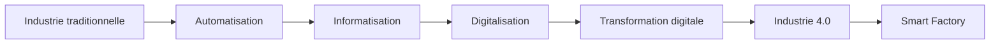
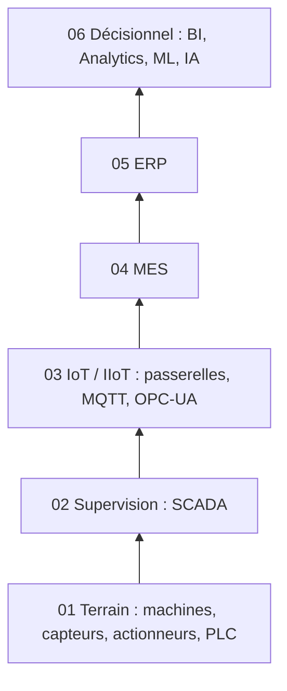
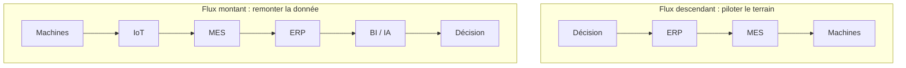
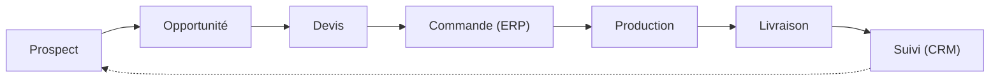
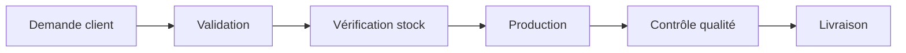
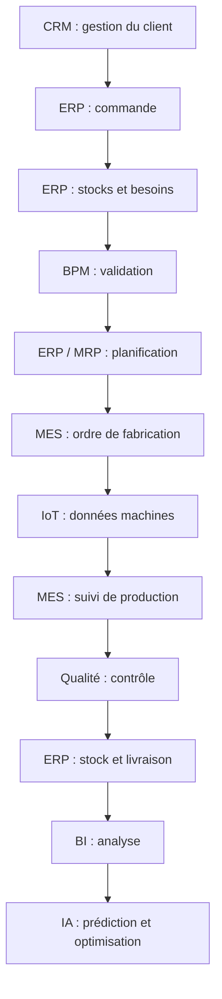
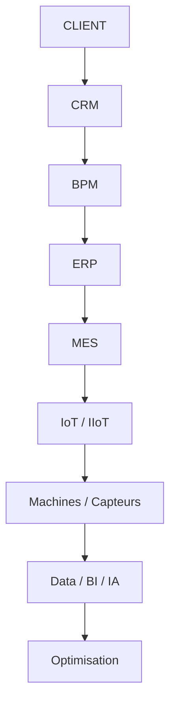

# Chapitre 1 : Généralités sur les Systèmes d'Information Industriels (SII) et les MES

*Module Smart Factory · ENSA Béni Mellal · Pr. BE ELBAGHAZAOUI*

[← Introduction](00-introduction.md) · [Chapitre 2 →](02-introduction-erp-industriels-odoo.md)

## Sommaire

1. De l'usine traditionnelle à la Smart Factory
2. Systèmes d'Information Industriels
3. Architecture d'une entreprise numérique
4. Industrie 4.0
5. ERP et MES : deux logiques complémentaires
6. CRM, BPM et la vue d'ensemble des systèmes
7. Odoo et la suite du module
8. Scénario industriel, cas pratique, synthèse

---

## 1. De l'usine traditionnelle à la Smart Factory

### Sept étapes, une même trajectoire

| Étape | Description |
|-------|-------------|
| Industrie traditionnelle | Ateliers manuels, décisions au feeling, papier et tableurs isolés |
| Automatisation | Des machines exécutent les tâches répétitives ; l'humain garde le pilotage |
| Informatisation | Les données de gestion entrent dans des logiciels, mais restent cloisonnées |
| Digitalisation | Les processus eux-mêmes sont repensés autour du numérique |
| Transformation digitale | L'organisation change de modèle : culture, décisions, offre |
| Industrie 4.0 | Machines, données et IA se connectent en temps réel |
| Smart Factory | L'usine devient un système piloté par la donnée, de bout en bout |

### Une usine avant / après sa transformation digitale

| Usine traditionnelle | Usine digitalisée |
|----------------------|-------------------|
| Informations dispersées entre ateliers, tableurs et papier | Un système d'information unique relie ateliers, bureaux et direction |
| Aucune visibilité sur l'état réel de la production | Tableaux de bord en temps réel, à tout niveau |
| Erreurs de saisie manuelle, ressaisies multiples | Données saisies une fois, à la source |
| Données disponibles seulement en fin de poste | Suivi continu, alertes immédiates |
| Traçabilité difficile à reconstituer a posteriori | Traçabilité automatique, lot par lot, opération par opération |
| Maintenance réactive, après la panne | Maintenance préventive et prédictive, avant la panne |
| Peu de données exploitables pour décider | Historique exploitable par le BI et le Machine Learning |

---

## 2. Systèmes d'Information Industriels et architecture numérique

### 2.1 Qu'est-ce qu'un SII ?

- **Définition simple** : l'ensemble des outils, des données et des personnes qui permettent à une entreprise industrielle de produire, de suivre et de décider.
- **Définition technique** : un ensemble organisé de ressources (matériel, logiciel, données, procédures, personnel) qui acquiert, traite, stocke et diffuse l'information nécessaire au pilotage de la production.
- **Rôle** : relier les décisions de gestion à la réalité de l'atelier, et faire remonter la réalité de l'atelier jusqu'à la décision.

### 2.2 Les composantes d'un SII

| Composante | Exemples |
|------------|----------|
| Matériels | Postes de travail, capteurs, automates, serveurs |
| Logiciels | ERP, MES, SCADA, applications métier |
| Données | Commandes, stocks, mesures, historique |
| Réseaux | Ethernet industriel, Wi-Fi, bus de terrain |
| Utilisateurs | Opérateurs, techniciens, responsables, direction |
| Processus | Les règles qui organisent la commande, la production et la livraison |

### 2.3 Six niveaux, une seule usine

| Niveau | Nom | Rôle |
|--------|-----|------|
| 01 | **Terrain** | Machines, capteurs et actionneurs qui exécutent physiquement la production |
| 02 | **Supervision** | SCADA et supervision industrielle : la vue d'ensemble sur l'atelier |
| 03 | **IoT / IIoT** | Capteurs connectés, passerelles et protocoles qui font remonter la donnée |
| 04 | **MES** | Pilotage en temps réel de la production, de la qualité et de la traçabilité |
| 05 | **ERP** | Gestion de l'entreprise : achats, ventes, stocks, finance, planification |
| 06 | **Décisionnel** | BI, Data Analytics, Machine Learning et IA : comprendre et prédire |

#### Niveau 01 : Terrain

- **Machines** : les équipements qui transforment la matière.
- **Capteurs** : mesurent température, vitesse, vibration, position.
- **Actionneurs** : traduisent une commande en action physique.
- **Robots** : automatisent des tâches répétitives ou précises.
- **PLC / API** : automates programmables qui pilotent la logique locale.

#### Niveaux 02-03 : Supervision et IoT / IIoT

**Supervision**
- **SCADA** (*Supervisory Control And Data Acquisition*) : supervision industrielle centralisée de l'atelier.
- Collecte des données machines en temps réel, sans les interpréter.

**IoT / IIoT**
- Capteurs connectés qui transmettent leurs mesures.
- **IoT Gateway** : passerelle qui agrège et relaie les données.
- **MQTT** : protocole léger, orienté messages.
- **OPC-UA** : standard industriel interopérable.
- **Edge Computing** : traitement au plus près de la machine.

#### Niveaux 04-05 : MES et ERP

| MES | ERP |
|-----|-----|
| Production | Achats |
| Qualité | Ventes |
| Traçabilité | Stocks |
| Maintenance | Finance |
| Suivi des opérations | Ressources et planification |

Ces deux niveaux sont détaillés à la section 4 de ce chapitre.

#### Niveau 06 : Décisionnel

- **BI** (Business Intelligence) : tableaux de bord et rapports.
- **Data Analytics** : analyse des historiques de production.
- **Machine Learning** : modèles qui apprennent des données machines.
- **IA** : prédiction et aide à la décision.

### 2.4 Le flux complet, dans les deux sens

---

## 3. Industrie 4.0 et Smart Factory

### 3.1 Quatre révolutions industrielles

| Révolution | Caractéristique | Technologies |
|------------|-----------------|--------------|
| Industrie 1.0 | Mécanisation | Vapeur |
| Industrie 2.0 | Production de masse | Électricité |
| Industrie 3.0 | Automatisation | Informatique, automates (PLC) |
| Industrie 4.0 | Systèmes intelligents | IoT, IA, Cloud, Data |

### 3.2 Les technologies qui la portent

- **IoT / IIoT** : connecter les machines et objets physiques.
- **Cloud Computing** : stocker et calculer à distance, à la demande.
- **Edge Computing** : traiter la donnée au plus près de la machine, sans latence.
- **Big Data** : exploiter des volumes de données que les outils classiques ne traitent pas.
- **IA & Machine Learning** : détecter des motifs et prédire.
- **Digital Twin** : simuler virtuellement une machine ou une ligne.
- **Robotique** : automatiser des tâches physiques complexes.
- **Systèmes cyber-physiques & cybersécurité** : relier le monde physique au numérique, et protéger cette liaison.

---

## 4. ERP et MES : gérer et exécuter

### 4.1 ERP : Enterprise Resource Planning

Un ERP centralise, dans une **base de données unique**, l'ensemble des informations de gestion de l'entreprise : achats, ventes, stocks, finance, ressources, production.

- **Avantages** : cohérence des données, visibilité globale, planification facilitée.
- **Limites** : mise en œuvre lourde, ne pilote pas le temps réel de l'atelier.

**Modules principaux** : Finance, Comptabilité, Achats, Ventes, Stocks, Logistique, Production, Maintenance, Qualité, Ressources humaines, Projets.

**L'ERP en pratique**

1. Un client commande 500 unités.
2. L'ERP vérifie le stock disponible.
3. Si insuffisant, il déclenche un besoin d'achat de matières.
4. Il planifie la production selon les capacités déclarées.
5. Il mobilise les ressources humaines et financières nécessaires.

> L'ERP décide **quoi** produire et avec quelles ressources, pas **comment** cela se déroule sur la ligne.

### 4.2 MES : Manufacturing Execution System

Le MES pilote et suit l'**exécution de la production en temps réel**, entre l'ordre de fabrication planifié par l'ERP et la réalité de l'atelier. Il se situe entre le niveau ERP (planification) et le niveau terrain (machines).

**Objectif** : exécuter, mesurer et tracer ce qui se passe réellement sur la ligne.

**Ce qu'il pilote au quotidien**

- Gestion des ordres de fabrication
- Suivi des opérations, des machines et des opérateurs
- Collecte des données terrain
- Contrôle qualité
- Traçabilité : lot, opération, matière
- Maintenance
- **TRS / OEE** (Taux de Rendement Synthétique)
- Temps réels de production

> **ERP** : gérer et planifier l'entreprise. **MES** : exécuter et suivre la production.

### 4.3 ERP vs MES

| Critère | ERP | MES |
|---------|-----|-----|
| Objectif | Planifier les ressources | Exécuter et suivre la production |
| Niveau | Gestion | Atelier |
| Utilisateurs | Direction, achats, finance | Opérateurs, techniciens |
| Horizon temporel | Semaines à mois | Secondes à heures |
| Production | Planifiée | Exécutée et mesurée |
| Stocks | Quantités globales | Consommation réelle en ligne |
| Machines | Non suivies directement | Suivies en temps réel |
| Qualité | Politique et normes | Contrôles et non-conformités |
| Traçabilité | Globale, par commande | Fine, par lot et opération |
| Temps réel | Non | Oui |
| KPI | Financiers, commerciaux | TRS, cadence, taux de rebut |

**Deux exemples industriels**

- **Une rupture de stock** : l'ERP détecte le seuil de réapprovisionnement atteint et déclenche un achat ; le MES n'intervient pas (sujet de gestion, pas d'exécution).
- **Une machine qui ralentit** : le MES détecte l'écart de cadence en temps réel et alerte l'opérateur ; l'ERP ne le voit que plus tard, dans un rapport de production.

---

## 5. CRM, BPM et la vue d'ensemble des systèmes

### 5.1 CRM : Customer Relationship Management

Le CRM centralise la relation avec les clients et les prospects : contacts, opportunités, devis, commandes, historique d'échanges.

- Suivre prospects et opportunités
- Générer des devis
- Suivre les commandes
- Conserver l'historique client

**CRM et ERP : une boucle continue**

Le CRM capte la demande ; l'ERP la transforme en ressources et en production.

### 5.2 BPM : Business Process Management

Le BPM **modélise, automatise et surveille** les processus métier de l'entreprise, indépendamment des logiciels qui les exécutent.

| Notion | Définition |
|--------|------------|
| Processus métier | Une suite d'étapes qui produit de la valeur |
| Workflow | L'enchaînement automatisé des tâches et validations |
| Monitoring | La mesure de la performance du processus |
| Amélioration continue | L'ajustement du processus à partir de ce qui est mesuré |

**De la demande à la livraison**

> Le BPM ne remplace pas l'ERP, le MES ou le CRM : il **orchestre** et automatise leur enchaînement.

### 5.3 ERP, CRM, BPM : trois logiques distinctes

| Critère | ERP | CRM | BPM |
|---------|-----|-----|-----|
| Objectif | Gérer les ressources | Gérer la relation client | Automatiser les processus |
| Données clés | Stocks, finance, production | Contacts, devis, commandes | Étapes, règles, validations |
| Utilisateurs | Direction, achats, finance | Commerciaux, service client | Pilotes de processus, IT |
| Exemple industriel | Planifier une commande de 1 000 pièces | Suivre le client jusqu'à la livraison | Automatiser la validation de la commande |
| Question à laquelle il répond | Quelles ressources et comment les gérer ? | Qui sont nos clients ? | Comment exécuter nos processus ? |

### 5.4 Sept systèmes, sept rôles

| Système | Fonction principale | Question à laquelle il répond |
|---------|---------------------|-------------------------------|
| CRM | Relation client | Qui sont nos clients et que veulent-ils ? |
| ERP | Gestion de l'entreprise | Quelles sont nos ressources et comment les gérer ? |
| BPM | Processus | Comment exécuter et automatiser nos processus ? |
| MES | Production | Que se passe-t-il dans l'atelier ? |
| IoT | Données terrain | Que se passe-t-il sur les machines ? |
| BI | Analyse | Que nous disent les données ? |
| IA | Intelligence | Que pouvons-nous prédire et optimiser ? |

---

## 6. Un scénario industriel complet

### Une commande de 1 000 pièces automobiles

Une entreprise fabrique des composants automobiles. Un client commande 1 000 pièces. Le scénario traverse, dans l'ordre, chaque système du chapitre.

| Étape | Système | Rôle |
|-------|---------|------|
| 1 | CRM | Gestion du client |
| 2 | ERP | Commande |
| 3 | ERP | Stocks et besoins |
| 4 | BPM | Validation |
| 5 | ERP / MRP | Planification |
| 6 | MES | Ordre de fabrication |
| 7 | IoT | Données machines |
| 8 | MES | Suivi de production |
| 9 | Qualité | Contrôle |
| 10 | ERP | Stock et livraison |
| 11 | BI | Analyse |
| 12 | IA | Prédiction et optimisation |

### Cas pratique : une usine fictive

Une usine avec **3 lignes de production, 20 machines, plusieurs capteurs IoT, un magasin, un service qualité, un service maintenance et un service commercial**.

**Travail demandé**

1. Identifier les systèmes nécessaires.
2. Positionner ERP, CRM, BPM et MES.
3. Identifier les données IoT à collecter.
4. Définir les flux de données entre systèmes.
5. Définir 5 indicateurs de performance (KPI).
6. Proposer une architecture Smart Factory.
7. Expliquer où Odoo pourrait intervenir.

---

## 7. Synthèse et révision

### La chaîne complète, de haut en bas

> **Une Smart Factory n'est pas une usine équipée de capteurs.** C'est l'intégration des équipements physiques, des données, des processus et des systèmes d'information.

### Dix questions de révision

1. Quelles sont les six composantes d'un Système d'Information Industriel ?
2. Quelle différence fondamentale sépare un ERP d'un MES ?
3. À quel niveau de l'architecture industrielle se situe un SCADA ?
4. Que signifient les sigles MQTT et OPC-UA, et à quoi servent-ils ?
5. Pourquoi dit-on que l'Industrie 4.0 relie le monde physique et le monde numérique ?
6. Quel rôle joue le CRM dans le flux qui mène à un ordre de fabrication ?
7. Que fait un BPM que ne font ni l'ERP, ni le MES, ni le CRM ?
8. Que mesure le TRS (Taux de Rendement Synthétique) ?
9. En quoi Axelor illustre-t-il la convergence entre ERP, CRM et BPM ?
10. Pourquoi la Smart Factory ne se résume-t-elle pas à l'ajout de capteurs ?

---

[← Introduction](00-introduction.md) · [Chapitre 2 →](02-introduction-erp-industriels-odoo.md)
