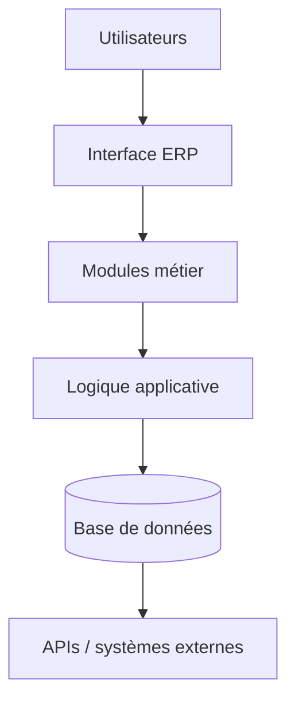
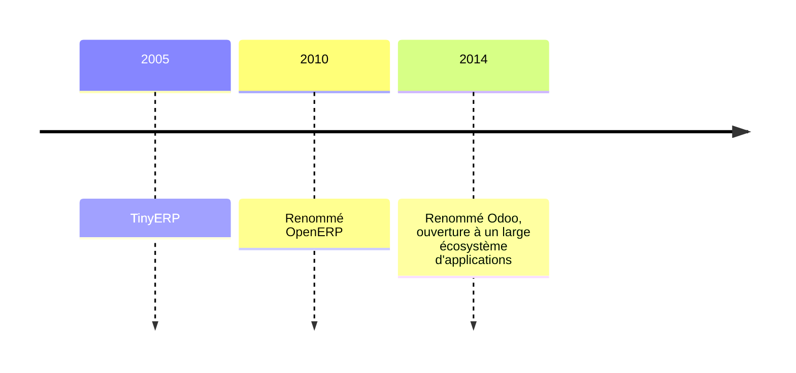
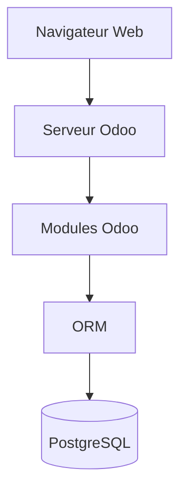
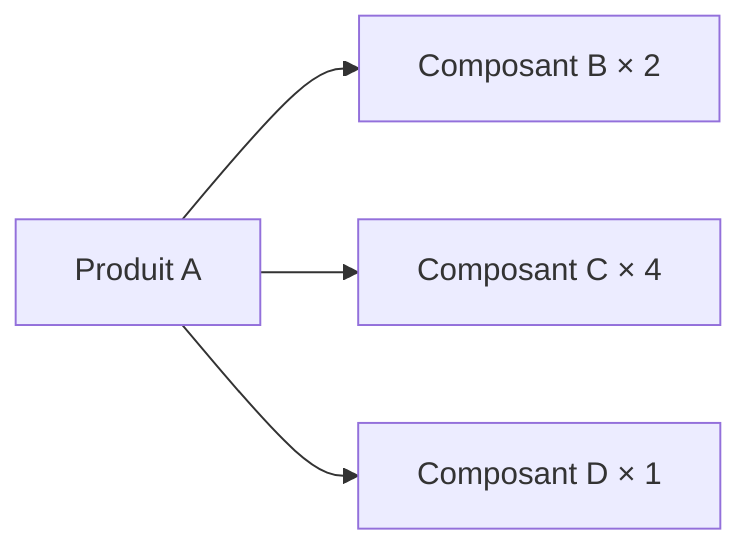
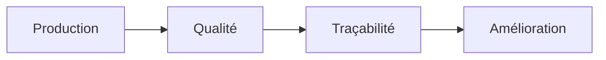
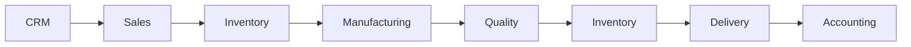
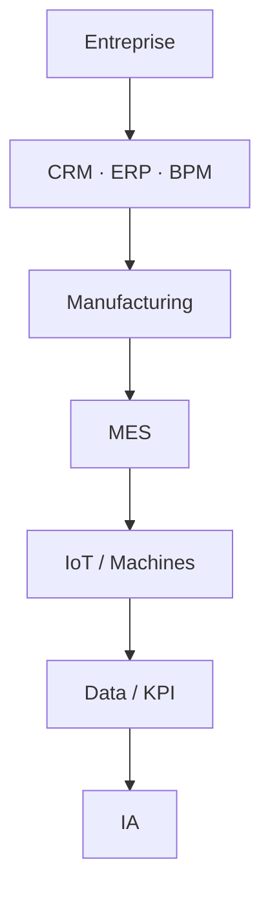

# Chapitre 2 : Introduction aux ERP industriels et rôle central d'Odoo

*Module Smart Factory · Cours magistral · ENSA Béni Mellal · Pr. BE ELBAGHAZAOUI*

[← Chapitre 1](01-systemes-information-industriels.md) · [Chapitre 3 →](03-configuration-odoo-mes.md)

## Sommaire

1. Pourquoi un ERP industriel
2. Architecture d'un ERP industriel
3. Les modules d'un ERP industriel
4. L'ERP et le flux de bout en bout
5. Introduction à Odoo
6. Architecture technique d'Odoo
7. Odoo et ses applications
8. Odoo et la fabrication (Manufacturing)
9. Odoo, IoT, maintenance et qualité
10. Odoo face aux autres ERP du marché
11. Exemple complet et vers la pratique
12. Synthèse et révision

---

## 1. Pourquoi un ERP industriel

Un **ERP** (*Enterprise Resource Planning*) centralise, dans une **base de données unique**, l'ensemble des informations de gestion de l'entreprise. Sans cette centralisation, chaque service gère ses propres données : les chiffres ne concordent plus, les décisions se prennent sur des informations incomplètes ou périmées.

### Une entreprise sans ERP

- Données dispersées, fichiers Excel multiples
- Doublons et erreurs de saisie
- Manque de synchronisation
- Stocks difficiles à connaître, commandes difficiles à suivre
- Coûts peu visibles
- Communication difficile entre services

### Une commande de 5 000 unités arrive : que se passe-t-il ?

Neuf services touchés par une seule commande : sans ERP, chacun travaille sur sa propre information.

---

## 2. Architecture d'un ERP industriel

| Couche | Rôle |
|--------|------|
| Utilisateurs | Accèdent à l'ERP selon leur rôle (achats, production, direction…) |
| Interface | L'écran, les formulaires, les tableaux de bord |
| Modules métier | Ventes, achats, stocks, production, qualité… |
| Logique applicative | Les règles de gestion qui traitent les données |
| Base de données | La source unique de vérité |
| APIs | Les échanges avec des systèmes externes (IoT, e-commerce…) |

---

## 3. Les modules d'un ERP industriel

### Modules amont : commerce, achats, stocks, production

| Module | Contenu |
|--------|---------|
| Gestion commerciale | CRM, ventes, devis, commandes |
| Achats | Fournisseurs, demandes de prix, commandes, réception |
| Stocks | Entrepôts, emplacements, mouvements, lots, numéros de série |
| Production | Nomenclatures, gammes, postes de travail, ordres de fabrication |

### Modules aval : maintenance, qualité, finance

| Module | Contenu |
|--------|---------|
| Maintenance | Équipements, maintenance préventive et corrective |
| Qualité | Contrôles, non-conformités, qualité fournisseurs |
| Finance | Facturation, comptabilité, coûts, analyse financière |

> Tous ces modules lisent et écrivent dans la **même base de données** : une commande saisie en vente est immédiatement visible en stock, en production et en finance.

---

## 4. L'ERP et le flux de bout en bout

### Un processus industriel complet

### Ce qui circule à chaque étape

| Étape | Module | Données créées / consommées |
|-------|--------|-----------------------------|
| Commande client | Ventes / CRM | Crée la commande, consomme le devis |
| Vérification stock | Stocks | Consomme les quantités disponibles |
| Achat matières | Achats | Crée une commande fournisseur |
| Production | Production | Consomme les composants, crée le produit fini |
| Facturation | Finance | Consomme la livraison, crée la facture |

---

## 5. Introduction à Odoo

### Qu'est-ce qu'Odoo ?

Odoo est une **suite d'applications intégrées** : chaque application couvre un domaine de gestion (ventes, achats, stocks, production…), et toutes partagent la même base de données. Sa philosophie est **modulaire** : on installe uniquement les applications dont on a besoin, et on peut en ajouter d'autres au fil de la croissance de l'entreprise.

### Cinq repères

| Repère | Description |
|--------|-------------|
| Origine | Projet open source, développé et étendu depuis plus de quinze ans |
| Modularité | Applications indépendantes mais connectées entre elles |
| Communauté | Une édition communautaire et une édition entreprise |
| Personnalisation | Modules additionnels développés selon les besoins |
| Intégration | Une API pour connecter des systèmes externes (IoT, e-commerce…) |

### Définition, histoire, technologies

- **Définition** : suite d'applications de gestion intégrées, open source, couvrant vente, achats, stocks, production et comptabilité.
- **Technologies** : Python côté serveur, ORM propre à Odoo, PostgreSQL pour les données, JavaScript et XML pour l'interface.

**Degré de complexité à maîtriser**

| Niveau | Activité |
|--------|----------|
| Facile | Utilisation fonctionnelle |
| Intermédiaire | Configuration métier |
| Avancé | Développement de modules |

---

## 6. Architecture technique d'Odoo

- **Navigateur** : l'interface que voit l'utilisateur, sans installation locale.
- **Serveur Odoo** : exécute la logique métier et sert les pages.
- **Modules** : chaque application (Ventes, Stocks, Production…) est un module.
- **ORM** (*Object-Relational Mapping*) : traduit les objets métier en tables de données.
- **PostgreSQL** : la base de données qui stocke toutes les informations.

### Vocabulaire à connaître

| Terme | Définition |
|-------|------------|
| Module | Une application installable (ex : Ventes) |
| Vue | La présentation d'un modèle à l'écran (liste, formulaire…) |
| Modèle | Une table de données (ex : un produit, un client) |
| Action | Ce qui se déclenche quand l'utilisateur clique |
| Champ | Une donnée d'un modèle (ex : le prix d'un produit) |
| Workflow | L'enchaînement des statuts d'un document |
| Droits d'accès | Ce que chaque utilisateur peut voir et modifier |

---

## 7. Odoo et ses applications

### Applications utiles pour Smart Factory

| Application | Rôle |
|-------------|------|
| CRM | Gestion clients et prospects |
| Sales | Gestion des ventes |
| Purchase | Gestion des achats |
| Inventory | Gestion des stocks |
| Manufacturing | Gestion de la fabrication |
| Maintenance | Gestion de la maintenance |
| Quality | Gestion de la qualité |
| IoT | Connexion aux équipements |
| Accounting | Gestion financière |

Ces applications ne sont pas des logiciels isolés : elles partagent les mêmes données et les mêmes processus.

### Cas d'étude : SmartAuto Manufacturing

3 lignes de production · 20 machines · 2 entrepôts · 50 employés · service qualité et maintenance · fournisseurs et clients multiples.

**Le parcours d'une commande chez SmartAuto**

---

## 8. Odoo et la fabrication (Manufacturing)

### Les concepts clés

| Concept | Définition |
|---------|------------|
| Produit | Le produit fini et ses composants |
| Nomenclature (BoM, *Bill of Materials*) | Les composants nécessaires pour fabriquer un produit |
| Poste de travail (*Work Center*) | Une ressource de production |
| Opération | Une étape de fabrication sur un poste |
| Ordre de fabrication | Le document qui déclenche et suit la production |

### Une nomenclature (exemple)

### Odoo et le MES

Odoo n'est pas simplement un outil de gestion administrative : son module Manufacturing suit les ordres de fabrication, les opérations, les postes de travail, la consommation des composants et la traçabilité, soit une partie importante des besoins d'un MES.

> Odoo **ne remplace pas systématiquement** un MES industriel spécialisé : pour un suivi machine très fin ou du temps réel critique, un MES dédié reste parfois nécessaire.

---

## 9. Odoo, IoT, maintenance et qualité

### IoT : de la machine à la décision

- Lecture d'un capteur de température ou de vibration
- Identification d'un équipement par étiquette ou code
- Déclenchement automatique d'une opération

### Maintenance : de l'anomalie à l'intervention

- Équipements suivis dans Odoo Maintenance
- Fréquence de maintenance préventive planifiée
- Historique complet des interventions

### Qualité : production, qualité, traçabilité

- Points de contrôle en production
- Contrôle à la réception fournisseurs
- Suivi des non-conformités

---

## 10. Odoo face aux autres ERP du marché

### Odoo vs Axelor (comparaison conceptuelle)

| Fonction | Odoo | Axelor |
|----------|------|--------|
| ERP | Cœur historique de la suite | Cœur historique de la suite |
| CRM / Ventes | Modules intégrés | Modules intégrés |
| Achats / Stocks | Purchase, Inventory | Modules équivalents |
| Production | Manufacturing + MES léger | Module de fabrication |
| Maintenance | Module dédié | Selon modules disponibles |
| Qualité | Module dédié | Selon modules disponibles |
| BPM / Workflow | Automatisations par module | Moteur de workflow central |
| IoT | Module IoT natif (IoT Box) | Non natif : intégration requise |
| Personnalisation | Open source + marketplace | Open source, personnalisable |
| Écosystème | Gestion + exécution industrielle | Gestion et processus transverses |

Aucune plateforme n'est déclarée gagnante : chacune répond au même besoin avec une architecture différente.

### Odoo, SAP, Sage

| Critère | Odoo | SAP | Sage |
|---------|------|-----|------|
| Positionnement | Suite modulaire, du PME au grand groupe | Leader mondial ERP grands groupes | ERP / comptabilité orienté PME |
| Modèle | Open source + édition Entreprise | Propriétaire, sous licence | Propriétaire, licence / abonnement |
| Déploiement | Modulaire, coût progressif | Lourd, coût élevé | Plus léger, coût modéré |
| Production / MES | Manufacturing + MES léger, IoT natif | Modules production avancés (PP, MES via SAP ME) | Peu ou pas de production dédiée |
| Cible privilégiée | PME à ETI, projets flexibles | Grands groupes, multinationales | TPE / PME, gestion administrative |

*Comparaison conceptuelle : les fonctionnalités précises dépendent des versions et modules installés.*

### Définition, histoire, technologie, complexité

| Critère | Odoo | Axelor | SAP | Sage |
|---------|------|--------|-----|------|
| Définition | Suite modulaire open source | ERP + CRM + BPM intégré | ERP intégré grands groupes | ERP / compta PME |
| Historique | 2005 TinyERP → 2014 Odoo | Créé en 2005 (France) | Fondé en 1972 (Allemagne) | Fondé en 1981 (Royaume-Uni) |
| Technologie | Python, PostgreSQL | Java, low-code | ABAP, HANA (in-memory) | Propriétaire, cloud |
| Complexité | Facile → avancée | Intermédiaire | Élevée | Faible à modérée |

---

## 11. Exemple complet et vers la pratique

### Scénario : une commande de 1 000 produits P1

**Les douze étapes de la commande**

| # | Étape | # | Étape |
|---|-------|---|-------|
| 1 | Création du client | 7 | Création de l'ordre de fabrication |
| 2 | Création du devis | 8 | Exécution des opérations |
| 3 | Confirmation de la commande | 9 | Contrôle qualité |
| 4 | Vérification du stock | 10 | Mise en stock |
| 5 | Vérification des composants | 11 | Livraison |
| 6 | Planification de la fabrication | 12 | Facturation |

### Ce que vous allez rencontrer dans Odoo

Base de données · Société · Utilisateurs · Rôles · Applications · Produits · Fournisseurs · Clients · Entrepôts · Emplacements · Nomenclatures · Postes de travail · Opérations · Ordres de fabrication

### Activité : remplacer Excel par Odoo

Une usine souhaite remplacer plusieurs fichiers Excel par Odoo. En groupe, identifiez :

- Quelles données doivent être migrées
- Quels processus doivent être digitalisés
- Quels modules doivent être installés
- Quelles données doivent être partagées entre modules
- Quels utilisateurs doivent être créés
- Proposez une architecture Odoo complète

---

## 12. Synthèse et révision

### Points clés à retenir

- Un ERP centralise les données de l'entreprise.
- Les modules ERP collaborent entre eux.
- Odoo fonctionne selon une architecture modulaire.
- Manufacturing est le cœur de la partie industrielle.
- Maintenance et Quality complètent le système.
- L'IoT connecte le monde physique au système numérique.
- Le MES rapproche gestion et exécution réelle.
- Odoo servira de plateforme principale pour les TP.

### Dix questions de révision

1. Pourquoi un ERP est-il indispensable dans une entreprise industrielle ?
2. Quelles sont les six couches de l'architecture d'un ERP ?
3. Quels modules partagent les mêmes données dans un ERP ?
4. Quelle est la philosophie modulaire d'Odoo ?
5. Quelles applications Odoo interviennent dans le module Smart Factory ?
6. Que signifie ORM et quel est son rôle dans Odoo ?
7. Qu'est-ce qu'une nomenclature (BoM) ?
8. En quoi Odoo couvre-t-il une partie des besoins d'un MES ?
9. Quel est le principe de la chaîne Odoo IoT ?
10. Pourquoi Odoo ne remplace-t-il pas systématiquement un MES dédié ?

---

[← Chapitre 1](01-systemes-information-industriels.md) · [Chapitre 3 →](03-configuration-odoo-mes.md)
