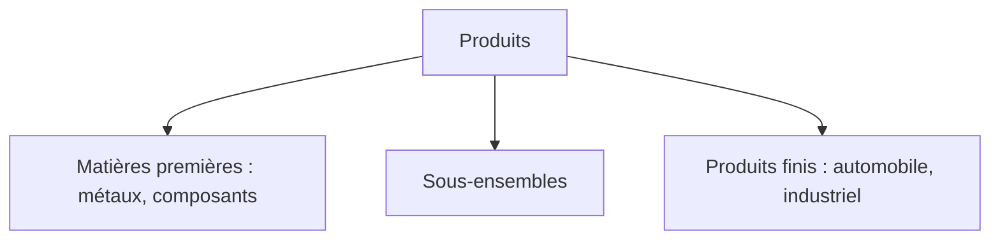
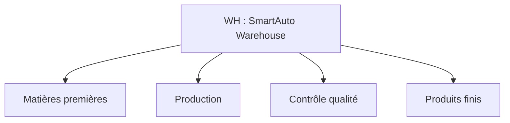
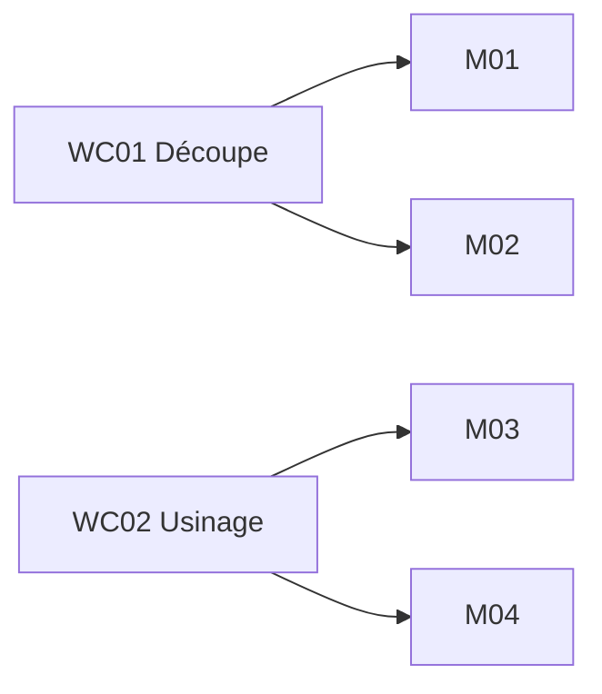
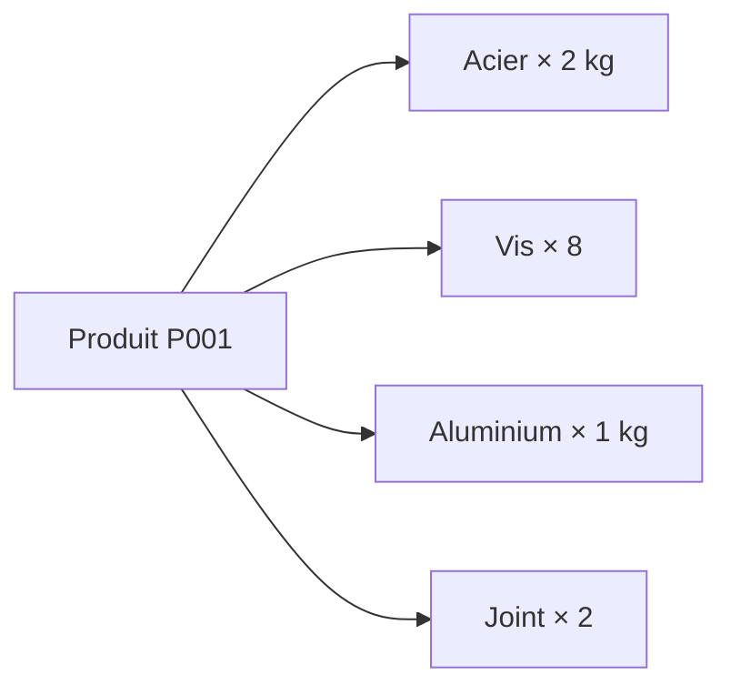
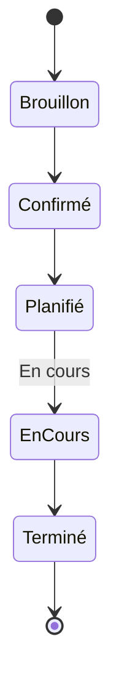

# Chapitre 3 : Configuration de base d'Odoo pour le MES

*Module Smart Factory · Cours et guide de travaux pratiques · ENSA Béni Mellal · Pr. BE ELBAGHAZAOUI*

[← Chapitre 2](02-introduction-erp-industriels-odoo.md) · [Introduction](00-introduction.md)

## Sommaire

1. De la théorie à la pratique
2. L'environnement Odoo
3. Entreprise et utilisateurs
4. Applications à installer
5. Produits, catégories, unités de mesure
6. Entrepôts et emplacements
7. Postes de travail et machines
8. Nomenclature et opérations
9. L'ordre de fabrication
10. Suivi et traçabilité
11. Cas pratique complet
12. TP guidé, erreurs fréquentes, évaluation
13. Synthèse et révision

---

## 1. De la théorie à la pratique

Les chapitres 1 et 2 ont montré ce qu'est un ERP, ce qu'est un MES et pourquoi Odoo peut être utilisé dans un environnement industriel. Ce chapitre **construit un environnement industriel réel dans Odoo**.

### Objectif : construire progressivement

---

## 2. L'environnement Odoo

Éléments de l'interface : tableau de bord, applications, menus, vues liste, vues formulaire, filtres et recherche, vues Kanban, rapports.

### Activité : découvrir l'interface

Ouvrez une application Odoo (par exemple Inventory) et repérez :

- La barre d'applications et le menu principal
- Une vue liste et une vue Kanban du même modèle
- Un filtre et une recherche sauvegardée
- Un bouton d'action et un rapport disponible

---

## 3. Entreprise et utilisateurs

### Cas d'étude : SmartAuto Manufacturing

Fabrication de composants automobiles : 3 lignes de production, plusieurs machines, magasins MP (matières premières) et PF (produits finis), service qualité, service maintenance.

### Les informations générales de l'entreprise

Nom, adresse, pays, devise. Elles conditionnent la devise des documents, les formats d'adresse et les règles fiscales appliquées par l'ERP.

**Procédure**

1. Aller dans **Paramètres > Paramètres généraux**.
2. Dans la section *Sociétés*, repérer le bloc de votre société (ex. « My Company »).
3. Cliquer sur **Mettre à jour les informations**.
4. Remplir le champ **Nom** avec le nom de l'entreprise.
5. Remplir l'**Adresse** (rue, ville, code postal).
6. Choisir le **Pays** dans la liste déroulante.
7. Choisir la **Devise** de l'entreprise.
8. Cliquer sur **Enregistrer** pour valider.

### Les profils types d'un environnement industriel

| Profil | Accès principal |
|--------|-----------------|
| Administrateur | Accès global à toutes les applications |
| Responsable production | Manufacturing, Planning, Work Centers, ordres de fabrication |
| Responsable stock | Inventory, produits, mouvements, entrepôts |
| Opérateur | Opérations de production sur son poste |
| Responsable qualité | Quality, contrôles, non-conformités |
| Responsable maintenance | Maintenance, équipements, demandes |

### Vocabulaire des droits d'accès

- **Utilisateur** : une personne qui se connecte au système.
- **Groupe** : un ensemble de droits partagés par plusieurs utilisateurs.
- **Rôle** : la fonction métier associée à un ou plusieurs groupes.
- **Droit d'accès** : ce qu'un utilisateur peut voir ou modifier.

---

## 4. Applications à installer

| Application | Rôle dans le projet |
|-------------|---------------------|
| Manufacturing | Ordres de fabrication et opérations |
| Inventory | Stocks, entrepôts, mouvements |
| Purchase | Achats de matières premières |
| Sales | Commandes clients qui déclenchent la production |
| Maintenance | Équipements et interventions |
| Quality | Contrôles et non-conformités |

### Les dépendances fonctionnelles

Installer une application peut activer ou révéler des fonctionnalités dans les applications voisines.

---

## 5. Produits, catégories, unités de mesure

### Le concept de produit

Types : produit fini, sous-ensemble, matière première, consommable. Pour chaque produit : nom, référence interne, type, catégorie, unité de mesure, prix, coût, fournisseur et informations logistiques.

### Les produits de SmartAuto Manufacturing

- **Produits finis** : P001 (Boîtier automobile), P002 (Support métallique)
- **Matières premières** : acier, aluminium, vis, composants électroniques

### Une structure de catégories

### Les unités de mesure

Unité, kilogramme, mètre, litre, heure. Une matière première peut être achetée en kilogrammes mais consommée en production selon une autre unité : les **conversions** garantissent la cohérence des quantités dans tout l'ERP.

---

## 6. Entrepôts et emplacements

### WH : SmartAuto Warehouse

### Inventory et Manufacturing

Chaque mouvement de fabrication est aussi un mouvement de stock : consommer un composant retire du stock matières premières, produire ajoute au stock produits finis. Mouvements concernés : réception, transfert, consommation en production, livraison.

---

## 7. Postes de travail et machines

### Qu'est-ce qu'un poste de travail ?

Un **poste de travail** (*Work Center*) représente une ressource ou une zone dans laquelle une ou plusieurs opérations de fabrication sont réalisées.

**Les quatre postes de SmartAuto** : WC01 Découpe · WC02 Usinage · WC03 Assemblage · WC04 Contrôle qualité

**Attributs** : capacité, calendrier, temps de préparation, temps de nettoyage, coût, disponibilité.

### Des postes aux machines

- **Poste de travail** : une zone de production.
- **Machine** : un équipement physique installé sur ce poste.
- **Équipement de maintenance** : la même machine suivie côté Maintenance.

---

## 8. Nomenclature et opérations

### Bill of Materials : le produit P001

Une nomenclature contient : produit, composants, quantités, opérations. Elle est indispensable au calcul des besoins, à la consommation, à la production, aux coûts et à la traçabilité.

### Gamme de fabrication : les opérations de P001

Une opération définit : nom, poste de travail, durée, ordre, instructions.

---

## 9. L'ordre de fabrication

### Fabriquer 100 unités du produit P001

Un ordre de fabrication (*Manufacturing Order*) précise : produit, quantité, nomenclature, date planifiée.

### Cycle de vie

Les intitulés exacts des statuts peuvent varier légèrement selon la version d'Odoo utilisée.

### Les dix étapes de l'exécution

### Ce qui évolue pendant l'exécution

---

## 10. Suivi et traçabilité

### Informations suivies en cours de production

Quantité planifiée · quantité produite · temps prévu / réel · opérateur, poste · productivité, rendement. Ces données ouvrent la voie au **TRS / OEE** (chapitres suivants).

### Du lot matière première au client

Secteurs concernés : automobile, aéronautique, agroalimentaire, pharmaceutique.

### Bilan : un premier lien avec le MES

Exécution, suivi, traçabilité. La configuration ERP constitue la base de données et de processus sur laquelle le suivi industriel peut être construit.

---

## 11. Cas pratique complet

### Mini-projet : produire 100 unités du support automobile P001

- **Nomenclature** : acier 2 kg, vis 8 unités, joint 2 unités
- **Opérations** : Découpe WC01, Usinage WC02, Assemblage WC03, Contrôle WC04
- **Objectif** : produire 100 unités

### Les quatorze étapes à réaliser

| # | Étape | # | Étape |
|---|-------|---|-------|
| 1 | Créer l'entreprise | 8 | Créer la nomenclature |
| 2 | Créer les utilisateurs | 9 | Créer les opérations |
| 3 | Installer les applications | 10 | Créer l'ordre de fabrication |
| 4 | Créer les produits | 11 | Exécuter la fabrication |
| 5 | Créer les catégories | 12 | Vérifier les stocks |
| 6 | Configurer l'entrepôt | 13 | Vérifier la traçabilité |
| 7 | Créer les postes de travail | 14 | Analyser les résultats |

---

## 12. TP guidé, erreurs fréquentes, évaluation

### Structure de chaque étape du TP

Chaque étape comprend : **Objectif · Pré-requis · Procédure · Résultat attendu · Question**.

*Exemple de question : pourquoi la création d'une nomenclature est-elle indispensable avant de lancer certains ordres de fabrication ?*

### Erreurs fréquentes

| Erreur | Conséquence | Solution |
|--------|-------------|----------|
| Nomenclature incomplète | Ordre de fabrication bloqué | Vérifier chaque composant avant de lancer |
| Composant indisponible | Impossible de démarrer la production | Contrôler le stock avant confirmation |
| Unité incorrecte | Quantités faussées | Vérifier les conversions d'unités |
| Utilisateur sans permission | Action refusée | Vérifier les droits d'accès du profil |

### Évaluation : produire 500 unités (exercice individuel)

À partir d'une nomenclature, d'une liste de machines, d'opérations, de capacités et d'un stock initial fournis, l'étudiant doit configurer les données, créer l'ordre de fabrication, exécuter la production et analyser les résultats. **Grille d'évaluation sur 20 points.**

---

## 13. Synthèse et révision

### Les éléments configurés et leur rôle

| Élément | Rôle |
|---------|------|
| Entreprise | Organisation générale |
| Utilisateur | Accès au système |
| Produit | Élément fabriqué ou consommé |
| Entrepôt / emplacement | Gestion et localisation du stock |
| Work Center / machine | Ressource et équipement de production |
| BoM / opération | Structure du produit et étapes de fabrication |
| Manufacturing Order | Ordre de production |
| Lot / série, Quality, Maintenance | Traçabilité, contrôle, équipements |

### Le processus complet en une chaîne

### Dix questions de révision

1. Quels sont les éléments à configurer avant de créer un ordre de fabrication ?
2. Quelle est la différence entre poste de travail et machine ?
3. Quelles informations contient une nomenclature ?
4. Comment la traçabilité relie-t-elle un lot matière première à un client ?
5. Pourquoi les unités de mesure doivent-elles être converties ?
6. Quelles données sont nécessaires pour créer un Work Center ?
7. Pourquoi une nomenclature incomplète bloque-t-elle la production ?
8. Quel est le cycle de vie d'un ordre de fabrication ?
9. Quels profils utilisateurs sont nécessaires dans SmartAuto Manufacturing ?
10. En quoi la configuration ERP prépare-t-elle le suivi de type MES ?

---

[← Chapitre 2](02-introduction-erp-industriels-odoo.md) · [Introduction](00-introduction.md)
